# Ringkasan Eksperimen

**Mode:** DATA NYATA (UCI HAR)  
**Dibuat:** 2026-10-22T13:46:37+07:00  

Dataset: **UCI HAR (data nyata)** dengan 10.299 sampel. 561 fitur. 30 subjek.


## Status eksperimen

| Eksperimen | Status | Keterangan |
|---|---|---|
| A — Baseline | selesai | Random Forest, SVM (RBF), 1D-CNN |
| B — Lintas pengguna | selesai | Random Forest (leave_one_subject_out), SVM (RBF) (leave_one_subject_out), 1D-CNN (group_kfold_6) |
| C — Lintas perangkat | not_performed | UCI HAR hanya menyediakan satu perangkat (Samsung Galaxy S II, waist-mounted). Tidak ada variasi perangkat yang dapat dipakai untuk menguji generalisasi lintas perangkat. |
| D — Peningkatan generalisasi | selesai | random_forest, svm, cnn |


## Dataset dan integritas

| Atribut | Nilai |
|---|---|
| Sumber | UCI HAR (data nyata) |
| DOI | 10.24432/C54S4K |
| Jumlah sampel | 10299 |
| Jumlah fitur | 561 |
| Jumlah subjek | 30 |
| Train / test | 7352 / 2947 |
| Perangkat | Samsung Galaxy S II |
| Sampling rate | 50 Hz |
| Window | 128 sampel (2.56 s) |
| Overlap | 0.5 |
| Nilai kosong | 0 |
| Baris duplikat | 0 |
| Nama fitur duplikat (dinamai ulang) | 84 |
| Sinyal mentah tersedia | True |
| Lisensi | Dataset UCI HAR didistribusikan AS-IS. Penggunaan dalam publikasi wajib mensitasi Anguita et al. (2013). README dataset menyatakan penggunaan komersial dilarang. |


**Peringatan verifikasi:**

- features.txt UCI memiliki nama fitur duplikat; nama telah dibuat unik dengan sufiks __dupN tanpa mengubah urutan kolom.

> Fitur 561 dimensi adalah fitur prakomputasi dari pembuat dataset. Pipeline ini tidak mengekstrak ulang fitur tersebut dari sinyal mentah. Sinyal mentah 128×9 hanya dipakai oleh 1D-CNN.


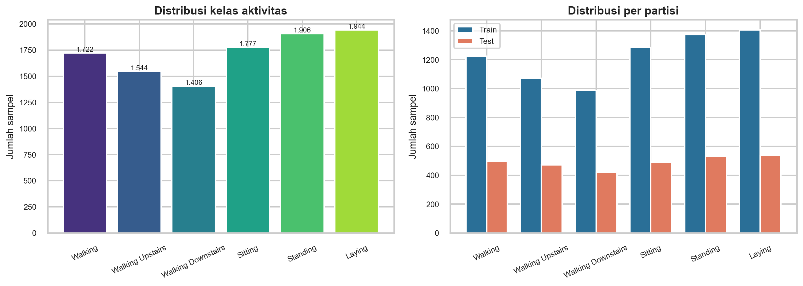


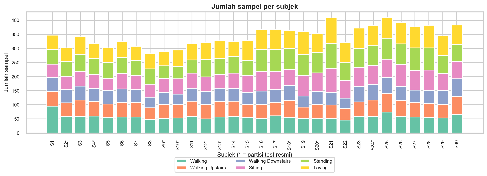


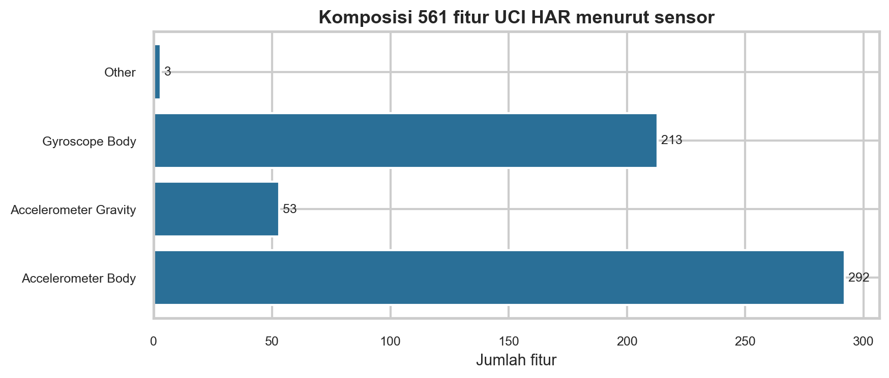


## Eksperimen A — Baseline pada split resmi

Protokol: `official_subject_disjoint`. Subjek latih: 1, 3, 5, 6, 7, 8, 11, 14, 15, 16, 17, 19, 21, 22, 23, 25, 26, 27, 28, 29, 30; subjek uji: 2, 4, 9, 10, 12, 13, 18, 20, 24. Hyperparameter dipilih dengan GroupKFold pada subjek latih saja.

| Model | Accuracy | Macro-F1 | Balanced acc. | Latih (s) | Inferensi (s) |
|---|---|---|---|---|---|
| Random Forest | 0.925 | 0.923 | 0.922 | 6.417 | 0.100 |
| SVM (RBF) | 0.955 | 0.954 | 0.953 | 2.576 | 3.647 |
| 1D-CNN | 0.910 | 0.912 | 0.912 | 18.836 | 0.261 |


### F1 per kelas

| Aktivitas | Random Forest | SVM (RBF) | 1D-CNN |
|---|---|---|---|
| Walking | 0.926 | 0.964 | 0.977 |
| Walking Upstairs | 0.901 | 0.948 | 0.940 |
| Walking Downstairs | 0.896 | 0.945 | 0.954 |
| Sitting | 0.902 | 0.928 | 0.805 |
| Standing | 0.912 | 0.941 | 0.822 |
| Laying | 1.000 | 0.998 | 0.974 |


### Kesalahan yang paling sering

- **Random Forest:** Sitting → Standing (55 kasus, 11.2% dari kelas asal); Walking Downstairs → Walking Upstairs (44 kasus, 10.5% dari kelas asal); Standing → Sitting (40 kasus, 7.5% dari kelas asal)
- **SVM (RBF):** Sitting → Standing (48 kasus, 9.8% dari kelas asal); Walking Downstairs → Walking Upstairs (27 kasus, 6.4% dari kelas asal); Standing → Sitting (17 kasus, 3.2% dari kelas asal)
- **1D-CNN:** Sitting → Standing (117 kasus, 23.8% dari kelas asal); Standing → Sitting (60 kasus, 11.3% dari kelas asal); Walking Upstairs → Walking Downstairs (30 kasus, 6.4% dari kelas asal)

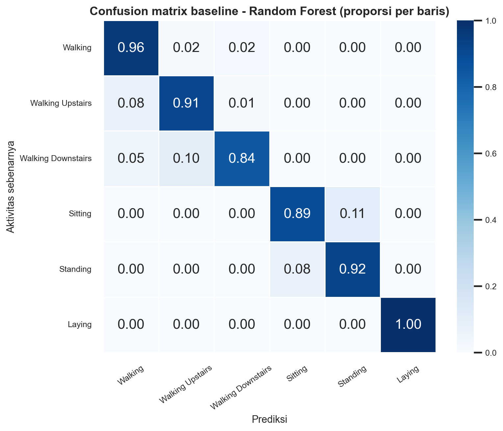


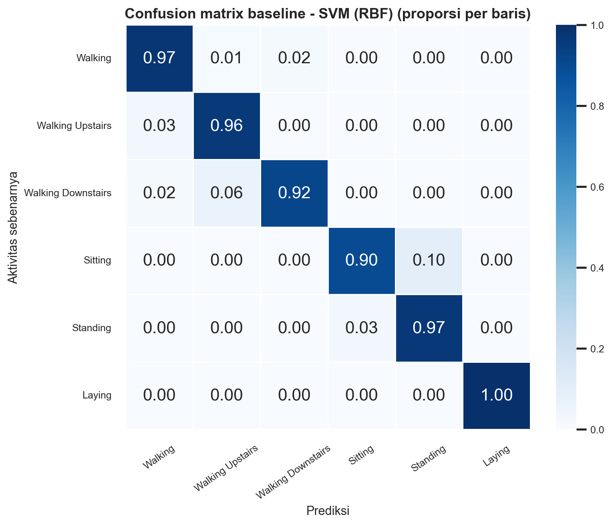


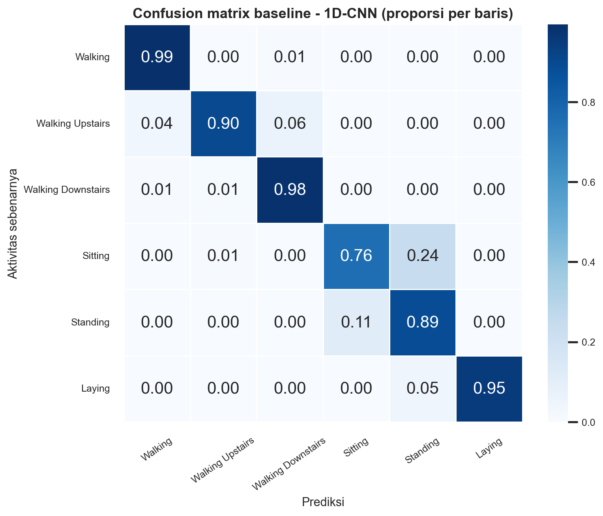


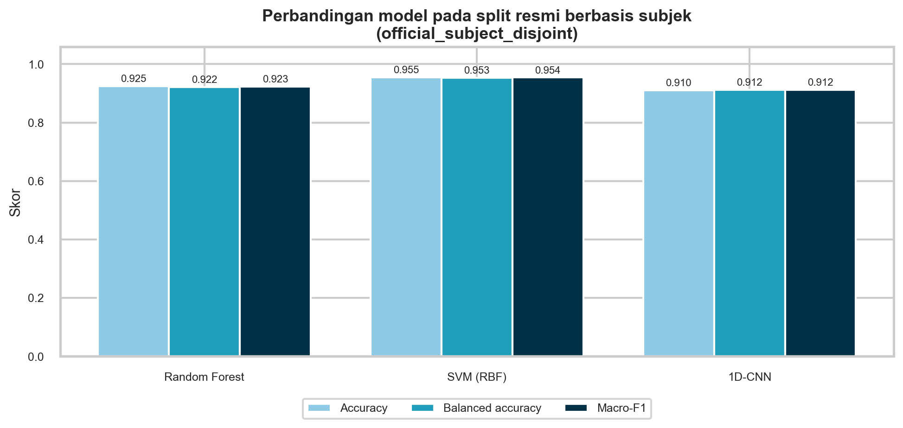


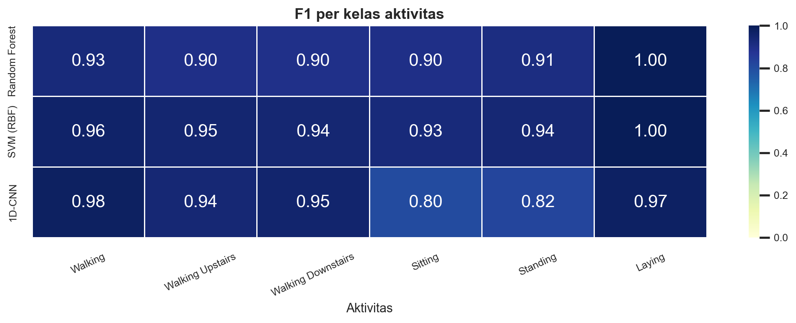


## Eksperimen B — Generalisasi lintas pengguna

| Model | Protokol | Fold | Macro-F1 | Balanced acc. | Latih/fold (s) |
|---|---|---|---|---|---|
| Random Forest | leave_one_subject_out | 30 | 0.931 ± 0.067 | 0.936 ± 0.057 | 8.551 |
| SVM (RBF) | leave_one_subject_out | 30 | 0.945 ± 0.058 | 0.948 ± 0.049 | 4.817 |
| 1D-CNN | group_kfold_6 | 6 | 0.932 ± 0.041 | 0.933 ± 0.041 | 26.050 |


> RF/SVM memakai Leave-One-Subject-Out (30 fold). CNN memakai GroupKFold(6) karena biaya pelatihan CPU; setiap subjek tetap diuji tepat sekali dan tidak pernah masuk pelatihan fold-nya. Baseline memakai split resmi 9 subjek uji; selisih baseline vs lintas pengguna tidak sepenuhnya sebanding karena protokol partisipan berbeda.


### Selisih terhadap baseline

| Model | Baseline macro-F1 | Lintas pengguna macro-F1 | Selisih | Penurunan relatif |
|---|---|---|---|---|
| Random Forest | 0.923 | 0.931 | -0.008 | -0.9% |
| SVM (RBF) | 0.954 | 0.945 | 0.009 | 1.0% |
| 1D-CNN | 0.912 | 0.932 | -0.020 | -2.2% |


### Variasi performa per subjek

| Model | Rata-rata macro-F1 | Std | Minimum | Maksimum | Subjek |
|---|---|---|---|---|---|
| Random Forest | 0.931 | 0.067 | 0.738 | 0.997 | 30 |
| SVM (RBF) | 0.945 | 0.058 | 0.730 | 0.997 | 30 |
| 1D-CNN | 0.923 | 0.085 | 0.689 | 1.000 | 30 |


### Kelas yang sering tertukar (out-of-fold)

- **Random Forest:** Standing → Sitting (193 kasus, 10.1% dari kelas asal); Sitting → Standing (132 kasus, 7.4% dari kelas asal); Walking Downstairs → Walking Upstairs (99 kasus, 7.0% dari kelas asal)
- **SVM (RBF):** Standing → Sitting (115 kasus, 6.0% dari kelas asal); Sitting → Standing (108 kasus, 6.1% dari kelas asal); Walking → Walking Upstairs (72 kasus, 4.2% dari kelas asal)
- **1D-CNN:** Standing → Sitting (281 kasus, 14.7% dari kelas asal); Sitting → Standing (257 kasus, 14.5% dari kelas asal); Walking → Walking Upstairs (105 kasus, 6.1% dari kelas asal)

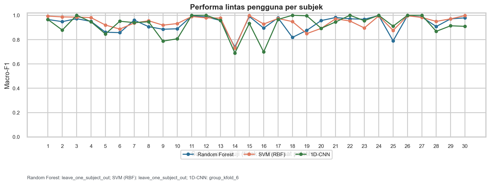


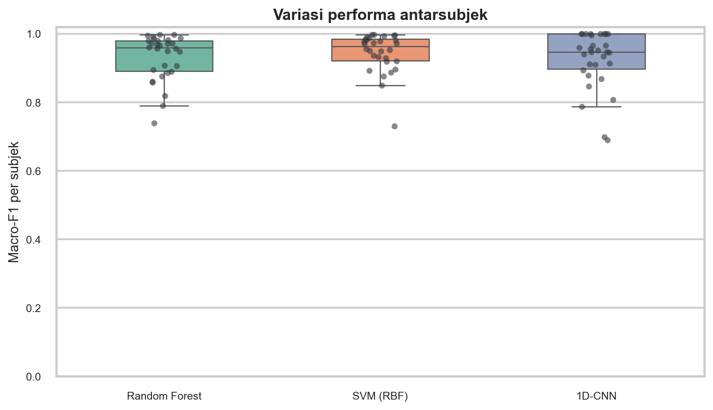


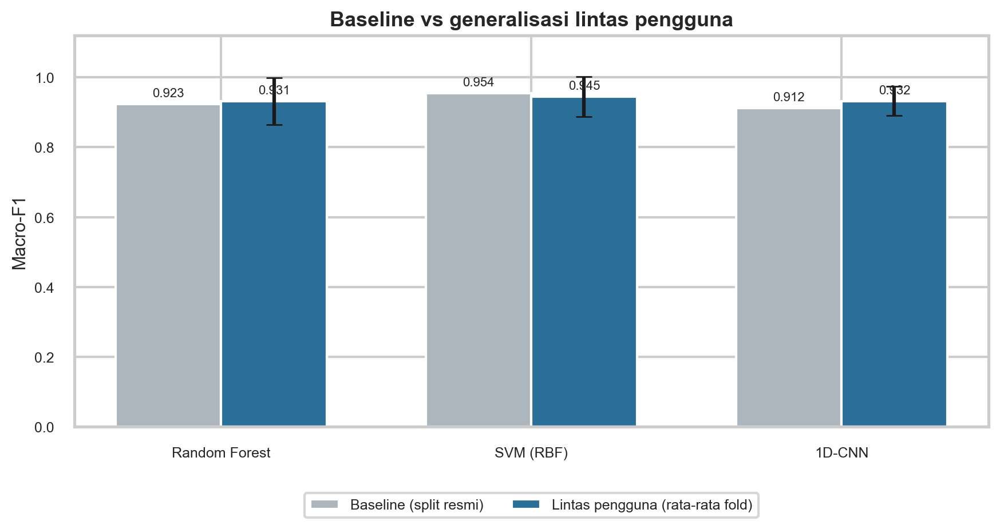


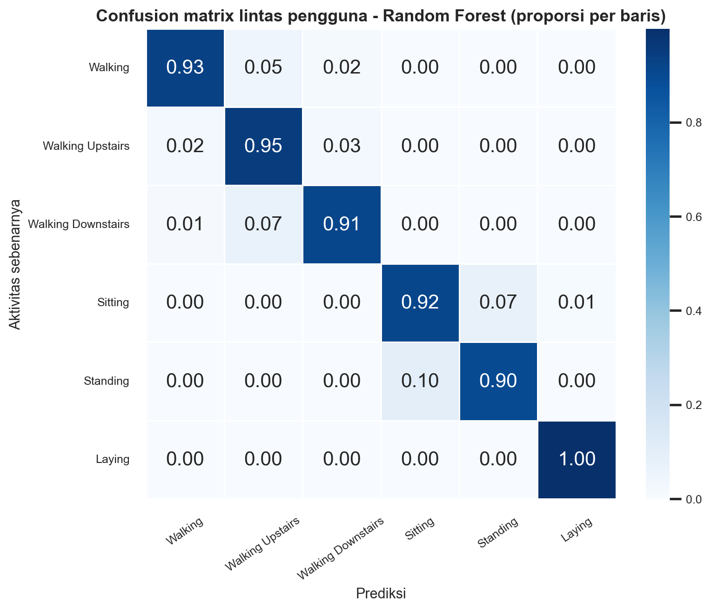


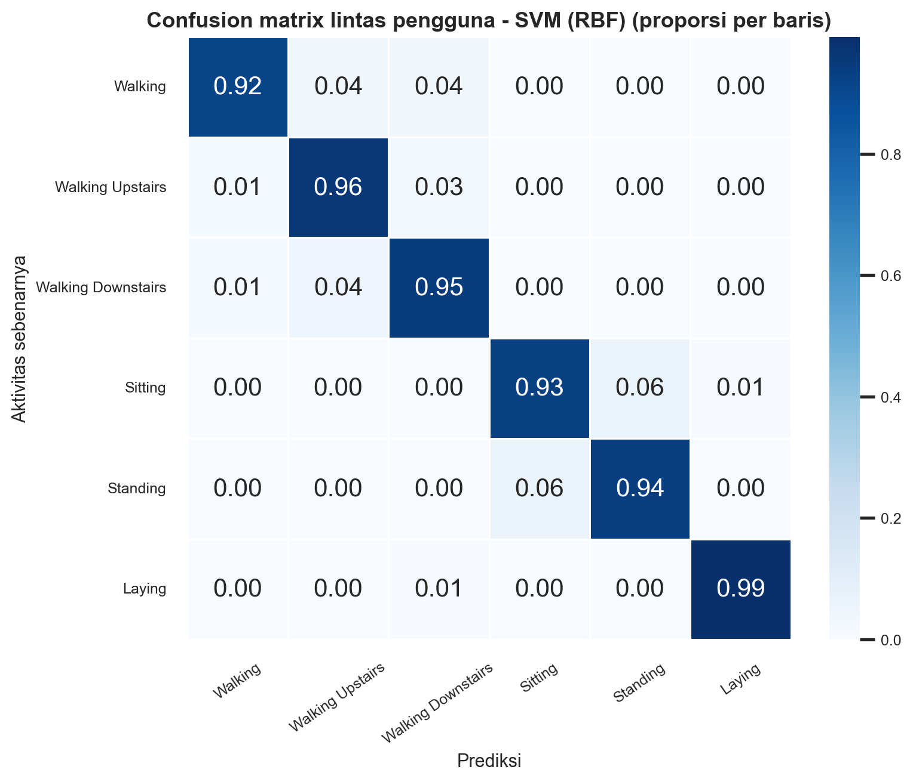


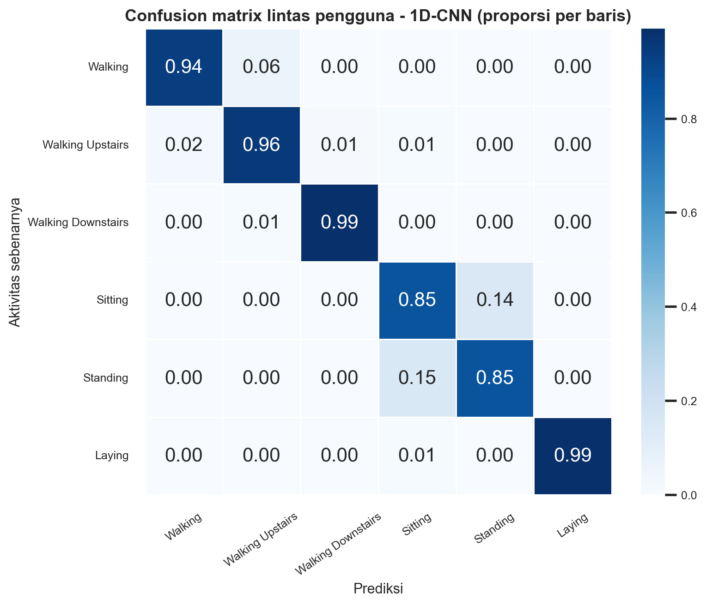


## Eksperimen C — Generalisasi lintas perangkat

**Status: `not_performed`**

Alasan: UCI HAR hanya menyediakan satu perangkat (Samsung Galaxy S II, waist-mounted). Tidak ada variasi perangkat yang dapat dipakai untuk menguji generalisasi lintas perangkat.

Kebutuhan data untuk menjalankan eksperimen ini:

- Minimal dua perangkat smartphone berbeda dengan sensor yang sama jenisnya.
- Protokol aktivitas identik (6 aktivitas, urutan dan durasi sama).
- Posisi pemasangan dan orientasi dicatat per sesi.
- Setiap perangkat memiliki data dari beberapa subjek (idealnya >= 5).
- Metadata perangkat: model, OS, vendor sensor, sampling rate, resolusi.
- Sinyal mentah tersedia dalam window 128 sampel x 9 kanal (50 Hz, overlap 50%).

Prosedur dan skema manifest: `docs/cross_device_protocol.md`.


## Eksperimen D — Strategi peningkatan generalisasi

Protokol: `group_kfold_6`; fraksi kalibrasi 10%; semua strategi dievaluasi pada subset target yang sama.

| Model | Strategi | Macro-F1 | Balanced acc. | Latih/fold (s) |
|---|---|---|---|---|
| Random Forest | base | 0.933 ± 0.028 | 0.933 ± 0.028 | 6.956 |
| Random Forest | subject_norm | 0.953 ± 0.018 | 0.953 ± 0.018 | 6.682 |
| Random Forest | calibration | 0.945 ± 0.022 | 0.945 ± 0.022 | 7.118 |
| SVM (RBF) | base | 0.943 ± 0.031 | 0.944 ± 0.030 | 3.321 |
| SVM (RBF) | subject_norm | 0.971 ± 0.012 | 0.971 ± 0.012 | 2.908 |
| SVM (RBF) | calibration | 0.968 ± 0.014 | 0.968 ± 0.013 | 3.513 |
| 1D-CNN | base | 0.931 ± 0.043 | 0.932 ± 0.042 | 25.551 |
| 1D-CNN | subject_norm | 0.944 ± 0.040 | 0.944 ± 0.040 | 29.387 |
| 1D-CNN | calibration | 0.952 ± 0.025 | 0.952 ± 0.025 | 43.867 |


### Perubahan relatif terhadap base

| Model | Strategi | Δ Macro-F1 | Δ Balanced acc. |
|---|---|---|---|
| Random Forest | base | 0.000 | 0.000 |
| Random Forest | subject_norm | 0.020 | 0.020 |
| Random Forest | calibration | 0.012 | 0.012 |
| SVM (RBF) | base | 0.000 | 0.000 |
| SVM (RBF) | subject_norm | 0.028 | 0.028 |
| SVM (RBF) | calibration | 0.025 | 0.025 |
| 1D-CNN | base | 0.000 | 0.000 |
| 1D-CNN | subject_norm | 0.013 | 0.013 |
| 1D-CNN | calibration | 0.021 | 0.020 |


Catatan: normalisasi per-subjek memakai data target tanpa label (transductive). Kalibrasi memakai sebagian label target dan mengevaluasi sisa data target. Augmentasi hanya tersedia untuk CNN.


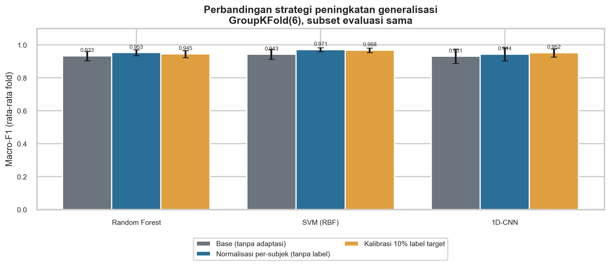


## Waktu komputasi

| Model | Latih baseline (s) | Inferensi baseline (s) | Rata-rata latih/fold lintas pengguna (s) |
|---|---|---|---|
| Random Forest | 6.417 | 0.100 | 8.551 |
| SVM (RBF) | 2.576 | 3.647 | 4.817 |
| 1D-CNN | 18.836 | 0.261 | 26.050 |


Waktu diukur pada CPU dan dapat berbeda antar mesin; angka ini bukan bagian dari klaim performa model.


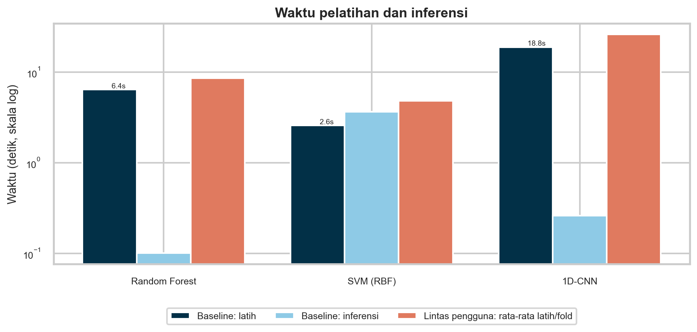


## Keterbatasan metodologis

- Dataset UCI HAR hanya berisi satu perangkat (Samsung Galaxy S II), sehingga tidak ada uji generalisasi lintas perangkat pada data nyata.
- 561 fitur UCI adalah fitur prakomputasi; pipeline tidak mengekstrak ulang fitur tersebut dari sinyal mentah. 1D-CNN memakai sinyal mentah 128×9.
- Hyperparameter RF/SVM dipilih sekali dengan GroupKFold pada subjek latih split resmi, lalu dibekukan untuk seluruh fold LOSO. Pemilihan nested per fold tidak dilakukan karena biaya komputasi; hal ini dapat memberi sedikit optimisme pada beberapa fold.
- CNN dievaluasi dengan GroupKFold(6), bukan 30 fold LOSO, karena keterbatasan CPU. Setiap subjek tetap diuji tepat sekali.
- Normalisasi per-subjek dan kalibrasi memerlukan data target (tanpa label untuk normalisasi, sebagian berlabel untuk kalibrasi); ini bukan skenario zero-shot murni.
- Hasil demo sintetis tidak boleh dilaporkan sebagai temuan penelitian.

## Cara mereproduksi

```bash
python scripts/prepare_data.py --download
python scripts/run_experiments.py
python scripts/generate_report.py
pytest -q
```
